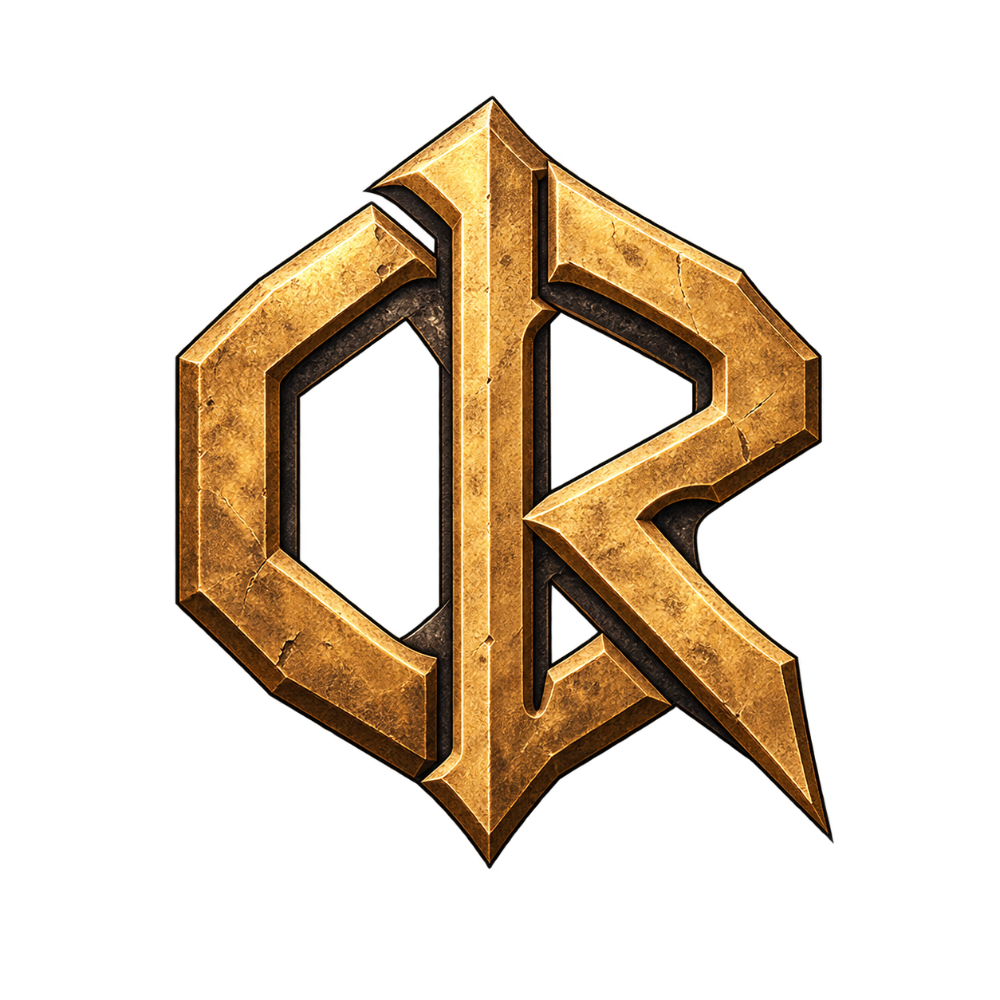

# Open Rune identity

The project is **Open Rune**. Use that spelling in prose, app listings and titles;
**OPEN RUNE** is the display wordmark. The original game is still **Rune Classic**,
and the engine fork is based on **SurrealEngine**. Preserve those attributions,
original-game terminology such as Rune power, and third-party license texts.

The emblem interlocks O and R in warm forged gold. Charcoal stone, ivory type and
restrained amber highlights match the existing menu/HUD theme. Menus pair the
emblem with a readable, two-line OPEN RUNE wordmark; the Android adaptive icon
uses the emblem alone on charcoal. Keep the supplied transparent padding so the
mark has space inside launcher masks.

## Assets and provenance

- [Transparent master PNG](../../Android/res/drawable-nodpi/open_rune_mark.png):
  1254×1254, with alpha. This is the Android resource and the README emblem.
- [Engine resource copy](../../Resources/open-rune-mark.png): identical bytes,
  bundled into the engine PK3 for desktop launcher/game-window icons.
- [Generation prompt](logo-prompt.txt): built-in image_gen tool, October 25, 2026.
  No original Rune logo, game image or third-party mod asset was used as input.
- Android adaptive-icon resources are under `Android/res/`. The original PNG is
  preserved; the app/platform handles scaling. The menu wordmark is native text.

## Stable technical identity

The display rename updates the existing Android app. Its package remains
`org.runeclassic.port`, using the existing signing key, saved preferences, game
files and save directories. The OPPO refresh exception continues to match that
same package. The current APK is **`build-android/apk/open-rune.apk`**.

Internal classes, CMake targets, `libruneclassic.so`, `SurrealEngine.pk3`, debug
markers, recovery identifiers and source-directory names remain compatible.
The private GitHub repository URL is unchanged. Old release links and diagnostic
evidence retain their original names and hashes; they are historical records,
not current branding. Original Rune Classic installation paths and the game
identification database still describe the original game. The upstream README,
component notices and original game scripts are not rebranded as our work.

## Verification

Validated on October 25, 2026:

- Android ARM64 and desktop builds pass; the desktop Rune package/level probe
  passes. The Java settings migration, packing and persistence tests pass.
- Updated the installed OPPO app using the existing signing key. Its manifest and
  Android App info show **Open Rune** and the O/R adaptive icon.
- Visually reviewed the installed title screen, Settings/Gameplay HUD-style
  selector and About screen. The new emblem and wordmark fit at both menu sizes.
- Preferences are byte-identical; all 10 protected normal/campaign save files
  retain their hashes. Package identity and the Rune-only refresh rule (3) remain
  unchanged. See [preservation results](preservation.json).
- The first launch exposed a stale Android engine-resource archive. CMake now
  tracks its resource inputs, and APK packaging verifies that the engine logo
  matches the Android master. The rebuilt and installed app launches correctly.

These are branding and startup checks, not new campaign or sustained-FPS claims.
Desktop source was built and probed; Windows packaging was not tested.
