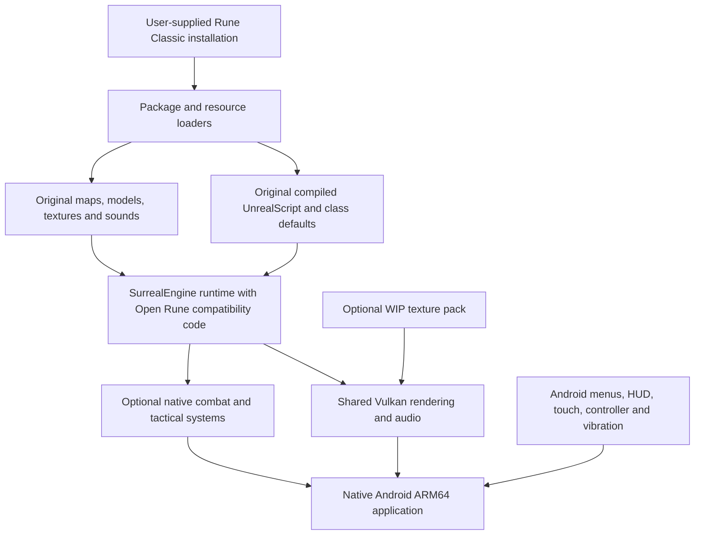

# Open Rune: project overview and development history

**Development snapshot: October 27, 2026.** This document describes the current working fork, including work newer than the last repository checkpoint. It is an account of the project and its tested boundaries, not a declaration of release readiness.

Open Rune brings **Rune Classic 1.11** to a native engine build, with Android ARM64 as the first playable target. It combines Rune's original game data and compiled UnrealScript with a substantially extended **SurrealEngine** fork, a Vulkan renderer, modern Android interfaces, optional graphical improvements, new combat mechanics and an experimental multiplayer implementation.

The aim is to preserve the original campaign and its character while making it comfortable to play on current tablets and handhelds. Compatibility work comes first; enhancements can be compared with original behavior where corresponding controls exist.

## Contents

- [What this project is](#what-this-project-is)
- [How it was built](#how-it-was-built)
- [What comes from where](#what-comes-from-where)
- [Engine and gameplay compatibility](#engine-and-gameplay-compatibility)
- [Graphics and performance](#graphics-and-performance)
- [Menus, HUD, controls and audio](#menus-hud-controls-and-audio)
- [Combat and enemy behavior](#combat-and-enemy-behavior)
- [Experimental multiplayer](#experimental-multiplayer)
- [WIP texture remastering](#wip-texture-remastering)
- [Testing and evidence](#testing-and-evidence)
- [Current boundaries and next work](#current-boundaries-and-next-work)
- [Source, assets and distribution](#source-assets-and-distribution)
- [Repository guide](#repository-guide)

## What this project is

Open Rune is a **native adaptation of an existing open-source engine**, with new implementations of missing Rune-specific behavior. SurrealEngine supplies the starting point: an Unreal Engine 1-compatible runtime, package loading, a script VM, rendering and supporting systems. Rune uses a modified Unreal Engine 1 technology base with its own skeletal models, joint APIs and gameplay conventions, so recognizing its installation was only the beginning of compatibility.

The fork began from SurrealEngine commit `a041728695b929fb51b019f8387bb42cc19cbf19`. The engine and its dependencies are compiled into ARM64 code for Android. Rune's original packages provide maps, textures, models, animation, sound, compiled scripts and serialized class defaults.

The Android client does **not** run Rune.exe through Wine, DroidDeck or an x86 instruction translator. DroidDeck was the location of the user's original installed game files during the initial investigation; it is not part of Open Rune's runtime. The original executable is not transformed into a new ARM executable through static recompilation.

The practical architecture is:

Android on the **OPPO Pad Mini OPD2515** is the primary device target. Native macOS builds support development, rendering checks and multiplayer tests. Windows, Linux and iOS are possible future targets, but the existence of shared C++ code or inherited desktop build support does not mean that current Open Rune gameplay is validated on those platforms.

## How it was built

### 1. Identify the installation and recover useful information

The initial investigation identified the installed game as Rune Classic 1.11 by its binary hash and package data. The original Windows binaries are 32-bit x86. The installation was copied for analysis without converting or overwriting the original assets.

Two kinds of evidence proved especially useful:

- **Embedded UnrealScript source text.** The shipped packages contain readable source text alongside compiled game data. The recovery tools extracted 3,015 text entries, representing 1,265 distinct contents after duplicate compatibility packages were accounted for. RuneI.u contributed 725 entries and Engine.u contributed 107. These counts are recovery results, not a count of newly written classes.
- **Selected native binary analysis.** REA and Ghidra were used to inspect exports, serialization, animation decoding and native functions in the original binaries, especially Engine.dll and RuneI.dll. Their pseudocode helped explain behavior missing from the replacement engine.

We did not recover a complete, original, buildable C++ game project. Ghidra pseudocode is analysis output, not the original source. Embedded script text also does not contain everything needed to rebuild the game: compiled defaults and other package data remain essential. The recovered text has not been established as a byte-for-byte behavioral substitute for all shipped bytecode.

### 2. Extend SurrealEngine to understand Rune

Upstream detection of Rune did not include the necessary implementation of its custom `SkelModel` resource and native joint interfaces at the inspected base revision. The work therefore began with decoding and validating models and animations, then integrating them into the runtime.

Ragnar's original model provided a useful structural check: 25 mesh variants, 38 joints, 612 animation sequences and 15,594 frame-table entries were parsed and checked against object bounds and index ranges. Standalone decoding, native binary evidence and the MIT-licensed UE Viewer Rune format implementation supplied complementary references.

The next stages connected those resources to script calls, attachments, collision, animation notifications and weapon sweeps. Small encounters and map transitions then exposed additional compatibility gaps that a model viewer could not reveal.

### 3. Build a playable Android application

SDL2 and the Android NDK provide the platform integration around the native engine. Vulkan renders the game. A custom Android layer supplies menus, settings, HUD, editable touch controls, physical-controller support and vibration routing.

Development proceeded through laptop probes, native ARM64 command-line checks and installed APK tests. Real touch and controller checks mattered: a function working through direct engine input did not always mean that an Android button delivered the same input correctly.

### 4. Add optional improvements around the original game

Once core play was possible, the fork added visual features, usability changes and new combat systems. Much of this work lives in native engine adapters and Android interfaces. Original game packages are retained; custom behavior does not require distributing rewritten proprietary packages.

The work has been developed through an ongoing **human-directed, AI-assisted process using Codex**, with the user selecting direction, testing playability and reviewing appearance. The repository includes substantial AI-authored changes. This is not represented as a formal clean-room reconstruction, an independently audited implementation or work endorsed by the original game or engine authors.

Detailed evidence: [initial investigation](Docs/RunePort/INVESTIGATION.md), [recovery tools](Tools/RuneRecovery/README.md), [upstream README](Docs/Upstream-README.md).

## What comes from where

| Component | Origin and role |
| --- | --- |
| Engine foundation | SurrealEngine and its existing dependencies; upstream history and attribution are retained. |
| Campaign content | The user's original Rune Classic packages, including maps, scripts, models, animation, audio and defaults. |
| Rune compatibility work | Fork-specific loaders, native bindings, animation and joint behavior, collision fixes and gameplay integration informed by source/package/binary evidence. |
| Android experience | Fork-specific menus, HUD, touch editors, controller handling, vibration backend and device/rendering integration. |
| Visual enhancements | Fork renderer changes plus attributed components such as Snapdragon GSR, FidelityFX CAS and OpenAL Soft. |
| Custom combat | New native integration using original animation and gameplay interfaces where applicable; some poses are adjusted procedurally. |
| Multiplayer | A new Open Rune protocol and engine integration, using established cryptography through Mbed TLS. |
| WIP remastered artwork | AI-assisted derivatives of original textures, prepared and stored separately from engine source. |

The environmental audio and surface-detail additions were written for this fork; existing Rune mod DLLs, presets and height-map packs were not imported for those features. That does not mean the whole project contains no third-party code: its engine, libraries, shader components and model-format references have explicit provenance and notices.

## Engine and gameplay compatibility

The compatibility work is broader than getting a level to render:

| Area | Work implemented in the fork |
| --- | --- |
| Packages and VM | Rune-specific native registrations and signatures, grouped resource lookup, configuration handling, struct storage/serialization fixes and useful missing-native diagnostics. |
| Skeletal models | Rune `SkelModel` loading, compressed animation decoding, CPU skinning, body/proxy animation groups and joint queries. |
| Attachments | Weapons, shields and other attached actors follow the same animated joint transforms used by the character. |
| Combat collision | Authored animation notifications, blade-frame sweeps, joint collision and shield/blocking integration. |
| Dynamic joints | Reconstructed spring/accelerative joint behavior, look offsets and force handling shared by rendering, attachments and queries. |
| World interaction | Moving-brush/Polyobj behavior, selected scripted mechanisms, climbing and ledge handling, swimming and underwater controls. |
| Inventory | Touch/controller Use, weapon and food pickup, throwing/dropping, automatic spare draw and fixes for misleading attachment or dropped-weapon poses. |
| Recovery | Themed death handling, checkpoint loading and a separate restart path for isolated practice fights. |
| Camera | Collision/crowding and character-fade fixes, including avoiding views through Ragnar when the camera is pressed against geometry. |

### Animation smoothness

The skeletal interpolation changes blend local joint positions, scales and shortest-arc rotations before building the hierarchy. Body animation and the upper-body animation proxy use their own fractional phases, including loop boundaries and interrupted transitions. Weapons and joint queries share this pose path.

This improves motion between authored frames. It does not speed up the original attack animations, invent new animation frames offline or change damage timing. Weapon sweeps retain their authored-frame sampling. The shared sampler also serves remote multiplayer actors.

Gib and limb movement received a separate timestep investigation. The project has not replaced Rune's entire physics system with a modern general-purpose physics engine.

### Campaign coverage

The opening village progression, training fight/alarm, ship sequence and selected underwater progression have been exercised. Cross-chapter fixtures also check exits, inventory continuity and save/load behavior. A user playtest confirmed the SinkingShip2 cracked-wall/flood interaction.

These are different levels of evidence. Loading a map, directly invoking an exit or restoring a destination save does not prove that every intervening puzzle and encounter works. **The entire campaign has not been completed and validated end to end.**

References: [campaign](Docs/RunePort/CAMPAIGN.md), [route coverage](Docs/RunePort/CAMPAIGN-ROUTE.md), [interpolation](Docs/RunePort/ANIMATION-NEXT.md), [dynamic joints](Docs/RunePort/DYNAMIC-JOINTS.md), [gib physics](Docs/RunePort/GIB-PHYSICS.md), [death recovery](Docs/RunePort/DEATH-RECOVERY.md).

## Graphics and performance

### Rendering features

The shared Vulkan renderer has grown beyond the initial compatibility path:

- **Original, Per-pixel and Remastered lighting modes**, covering characters, weapons and supported world surfaces.
- **Moving shadows** from one or up to three selected nearby lights, using bounded shadow coverage rather than shadows from every light across an entire level.
- **Material normals and roughness**, using prepared pack maps when available and procedural estimates on supported original textures.
- **Ground-contact shading** for nearby living characters, separate from directional shadow maps.
- **Bloom/color tuning, adaptive sharpening and up to 16× anisotropic filtering**, subject to device support.
- **Surface detail and surface depth** on eligible wood, rock and masonry. Detail adds relief shading; depth uses parallax rather than changing mesh geometry.
- **Original, Approximate and Full scene water.** Approximate uses a lightweight sheen/ripple treatment. Full scene performs a reflected scene render and can be substantially more expensive.
- **Widescreen framing and a 70–120° base FOV control**, with automatic aspect adjustment and safeguards for script-owned cinematic cameras.
- **4× MSAA support**, used as the principal device-validation baseline.

These are raster-rendering enhancements. The project does not currently provide ray tracing, global illumination or a completed HDR output pipeline.

### Resolution, upscaling and frame delivery

Android exposes Native/75%/50%/25% rendering resolution and two scaling paths:

| Path | What it does |
| --- | --- |
| Hardware Scaling | Gives Android a smaller game surface to scale for display. Dedicated display hardware is used when the device/compositor supports that path; Android can fall back to GPU composition. |
| Snapdragon GSR | Runs a spatial reconstruction/sharpening shader on the GPU. It is not dedicated upscaling hardware or frame generation. |

Percentages apply to **both dimensions**, not total pixel count. On the OPPO's 2520×1680 display, 50% is 1260×840 and 25% is 630×420. The Android menu, themed HUD and touch overlay remain at full display resolution. The original engine-drawn HUD follows the game surface if selected.

Fresh Android settings and Restore defaults now select **50% Hardware Scaling**; saved user choices are retained. GSR 25% has code support, but the latest quarter-resolution device check validated the Hardware Scaling path, not a separate GSR 25% rendered comparison.

Frame-rate target, refresh-rate request and frame pacing have distinct controls. Presets include 144 and 165, with manual values for other systems. A device cannot display an unsupported refresh rate just because the menu requests it. Android frame pacing uses Swappy; the development OPPO also has its own verified per-app 144 Hz rule.

### Optimization approach

The game's age does not make all modern effects inexpensive at high resolution. Profiling separated simulation, CPU submission, GPU scene time and actual display presentation. Major work has included early depth testing for ordinary opaque surfaces, preserving separate discard paths, bounded lighting arithmetic, reducing shadow work and avoiding unnecessary render-pass transitions.

Water was a useful example: an attractive shader can be cheap while rendering a second view of the whole scene is expensive. The lightweight water option avoids that second traversal entirely. Full reflections remain an explicit higher-cost choice.

Recorded optimization examples at **native 2520×1680 with 4× MSAA** include short displayed-FPS improvements of 80.39→89.24 in a hall view and 50.42→61.87 at the water wheel. Those are dated, scene-specific comparisons with documented settings—not current universal performance promises. Later combat and shadow passes have their own evidence. Some experimental optimizations were removed when measurements did not justify them.

**A 144 Hz screen, a 144 FPS target and 144 newly presented game frames per second are not the same thing.** Neither native nor scaled rendering is advertised as locked to that rate throughout the game.

References: [lighting](Docs/RunePort/REMASTERED-LIGHTING.md), [materials/water](Docs/RunePort/MATERIALS-WATER-SHADOWS.md), [optimization evidence](Docs/RunePort/RENDER-LIGHTING-PERFORMANCE.md), [system scaling](Docs/RunePort/SYSTEM-SCALING.md), [frame delivery](Docs/RunePort/FRAME-RATE-REFRESH.md), [widescreen](Docs/RunePort/WIDESCREEN.md).

## Menus, HUD, controls and audio

### Modern Android interface

The new interface uses an Open Rune theme with dark panels, gold trim and readable typography. Settings are organized by Video, Audio, Controls, Interface and Gameplay. Each setting has one parent section; diagnostics live under Support and connection smoothing under Multiplayer.

The menu includes save/load and death recovery, multiplayer status, graphics comparisons, runtime readouts and third-party notices. Open Rune branding and the O/R emblem replace the earlier prototype identity in the current interface; historical artifact names and the stable Android application ID remain where needed for continuity.

### Editable HUD and touch controls

- Health, shield, rune power, bloodlust, air, messages, FPS and score/time widgets can be moved and resized.
- Meters support compact horizontal and vertical layouts.
- Touch controls have separate layout editing, including both movement and camera joysticks, action buttons and Menu.
- Layouts can be adjusted through touch or controller-driven editing, with save/cancel behavior.
- Connecting a physical controller hides virtual movement/action controls while retaining the themed Menu button. Disconnecting restores the saved touch layout.
- Single-player and multiplayer text use more readable font paths, including a cached Noto Sans atlas for native canvas text.

### Physical controllers and rumble

Android controller handling includes sticks, D-pad, buttons, triggers and hotplug behavior. Menu navigation and gameplay input were tested separately because one could work while the other failed. Input fixes also ensure that a short touch press is not lost when press and release arrive in the same event batch.

Rumble is driven by portable gameplay feedback events and an Android backend. It uses OS-reported controller/device capabilities, with intensity and output selection, rather than hard-coding a Kishi-specific protocol. Actual feedback still depends on the hardware and driver; an advertised vibrator is not proof of a working actuator. Other platform backends remain future work.

### Environmental audio

The fork adds room reverb, obstruction-based muffling and optional headphone HRTF through OpenAL Soft. These are new integrations around existing audio, not a bundled legacy EAX mod. Bloodlust's repetitive berserk sound was replaced by a visible red head halo for eligible active characters.

References: [HUD](Docs/RunePort/HUD.md), [touch layout](Docs/RunePort/TOUCH-LAYOUT.md), [controllers](Docs/RunePort/CONTROLLERS.md), [rumble](Docs/RunePort/RUMBLE.md), [fonts](Docs/RunePort/READABLE-FONTS.md), [environmental audio](Docs/RunePort/WORLD-FEATURES.md).

## Combat and enemy behavior

The additions use explicit eligibility rules, cooldowns and existing collision/script interfaces. They are not blanket changes to every creature or scripted encounter.

| Addition | Player behavior | Enemy behavior and limits |
| --- | --- | --- |
| Kick | A committed close-range kick with knockback. A raised, facing shield reduces the result to a small impact. | Compatible humanoids can kick; creatures without the required animations do not gain the move. |
| Shield bash | Double-tap Block for a small shove and short stagger, with cooldown and protection against repeated stun. | Compatible shield-bearing enemies can bash; a correctly raised shield counters the full effect. |
| Dual wield | Selected one-handed weapons equip as a real pair, alternate attacks and provide a weaker crossed-weapon block. The shield remains stored. | Compatible Vikings can use pairs. Large/special weapons, incompatible skeletons and bosses are excluded. Also enabled under server authority in private multiplayer. |
| Bloodlust leap | Double-tap Jump for a larger directional leap while active bloodlust has sufficient meter. | Selected Dark Vikings can use a bounded leap near their opponent. Also enabled under server authority in private multiplayer. |
| Shield charge | Block + Attack while eligible: stow the weapon, brace the shield with both hands, tuck forward and rush in a fixed direction. | Selected eligible enemies can charge. A usable equipped shield is required; walls and blocked impacts constrain the move. Also enabled under server authority in private multiplayer. |

Bloodlust specials activate from the original bloodlust state and require at least half a meter. Each accepted move spends half and shares a four-second cooldown. They do not require the meter to remain exactly 100% after activation. Amber touch cues indicate availability. Constant bloodlust is an isolated test-session option, not normal gameplay, and is currently off.

Follow-up fixes address rush movement across low lips and stairs, normal ledge-grab handoff during a rage jump, dead actors' weapon poses, spare weapon drawing and whole-body consistency during dual-wield spins. Charge range was increased modestly while retaining its preparation and speed.

### Tactical enemies

The optional tactical controller improves eligible Viking, Goblin and Dwarf combat while leaving the original state machine responsible for acquisition, navigation, searching, pain, death and scripted orders. It applies during ordinary supported fighting states; bosses and cinematics retain their existing behavior.

Tactics include spacing, safe retreat, delayed reactions to visible attacks, finite blocking windows, kicks, shield bashes, flanking and limits on nearby simultaneous committed attackers. Decisions run at approximately 10 Hz; animation and physics continue at their normal rates. The system does not read hidden player button input to decide whether to block.

Difficulty affects reaction delay, recovery, defensive likelihood and attack coordination in addition to the original game's existing rules. This is more than increasing health or damage, but it is not a replacement AI for every enemy in the campaign. Original/Tactical comparison remains available.

References: [kick](Docs/RunePort/KICK.md), [bash](Docs/RunePort/SHIELD-BASH.md), [dual wield](Docs/RunePort/DUAL-WIELD.md), [bloodlust moves](Docs/RunePort/BLOODLUST-MOVES.md), [tactical AI](Docs/RunePort/TACTICAL-AI.md).

## Experimental multiplayer

The original game's networking was investigated through recovered scripts and binary analysis. That work helped identify game rules and engine integration points. The chosen implementation direction is nevertheless **Open Rune clients talking to an Open Rune server**, not wire compatibility with unmodified Rune Classic servers.

The new networking foundation is a standalone C++20 component, separate from rendering and the script VM. Its design was informed by research into Valve networking practices, ENet and melee fairness. It does not embed Valve's or ENet's complete networking stack. Authentication/encryption use Mbed TLS DTLS rather than newly invented cryptography.

Implemented areas include bounded packet formats, separate delivery lanes, reliable/replacement delivery, authentication, clock mapping, input and action admission, full/delta snapshots, authoritative combat, remote interpolation and limited client movement prediction. Grounded walking prediction does not imply prediction of swimming, falling or every special movement state.

### Melee fairness policy

The server owns contacts and committed results. A selected **two-tick/about 33 ms defense window** allows a valid block that was pressed on time but arrived slightly late to count, subject to clock, facing, shield, life and obstruction checks. Attack wind-up is retained. A press after contact is not retroactively made valid, and committed damage is never undone by a later block.

This policy covers ordinary weapon contacts and native kick/bash paths as documented. It is not unrestricted world rewind or arbitrary script rollback. Clock mapping remains an estimate, and automated timing cases do not establish that every human latency scenario feels fair.

### Current playable scope

| Mode | Representative map checked |
| --- | --- |
| Deathmatch | DM-Hildir, with DM-Thorstadt for rotation |
| Team Deathmatch | DM-Team_ships |
| Arena | AR-Champions |
| HeadBall | HB-Agora |

The current milestone is **private matches with two to sixteen invitation slots**, scoring/results, respawn, map travel, late join and reconnect, player hosting, direct joining and a laptop headless host. Laptop automation covers all 44 shipped multiplayer maps and 157 supported map/variant combinations. Some scoring/death fixtures deliberately position objects or invoke bounded events, so these are not full human matches. Sixteen is an admission ceiling, not a smooth-play guarantee under loss.

Networking is opt-in at build time. The current documented contract is protocol/ALPN 17, native rules 17, snapshot 6 and invitation 4; older checkpoints retain their historical versions. Host and clients must match. Automated checks cover late join/reconnect, vacant slots, inventory selection, combat feedback and 16-player loops. Public discovery/NAT, Windows hosting, Linux runtime, human fairness/audio and extended endurance remain unvalidated or unfinished. The installed Android build requires a matching rebuild.

**32-player battles, campaign co-op and compatibility with original public servers are not implemented milestones.** Dual wield, crossed blocking, bloodlust leap and shield charge have [server-authoritative multiplayer integration](Docs/RunePort/NETWORK-NATIVE-COMBAT.md), alongside kick and shield bash. Player hosting and headless laptop hosting are implemented; public discovery and NAT traversal remain in the [roadmap](Docs/RunePort/MULTIPLAYER-PLAN.md#server-browser-and-hosting-roadmap-accepted-october-27).

References: [current coverage and limits](Docs/RunePort/PRIVATE-MULTIPLAYER-STATUS.md), [hosting](Tools/RuneMultiplayer/README.md), [protocol](Docs/RunePort/PRIVATE-MULTIPLAYER-PROTOCOL.md), [responsiveness](Docs/RunePort/NETWORK-RESPONSIVENESS.md), [research](Docs/RunePort/MULTIPLAYER-RESEARCH.md), [original-network assessment](Docs/RunePort/ORIGINAL-MULTIPLAYER-PORT-ASSESSMENT.md), [standalone library](Network/README.md).

## WIP texture remastering

Texture work started with faithful local AI upscaling. Because the perceived improvement was limited, the project also explored generative remastering that adds detail while attempting to preserve the original palette, UV layout, silhouettes, masks and tiling relationships.

The pipeline records source/master hashes, exact generation prompts, review notes and build receipts. Prepared artwork receives color calibration and, where needed, blending with the source to reduce palette drift and overly busy surfaces. It produces 2× and 4× versions, complete mip chains, conservative material maps and ASTC-compressed runtime files.

The latest prepared pack installed on the tablet contains **151 logical texture entries from 128 approved masters**, including aliases, with both 2× and 4× mip chains. The queue also has 52 held candidates with recorded concerns and 1,490 pending jobs at the paused checkpoint. Those figures describe that checkpoint, not a complete remaster of the game. Generation remains paused.

Video → Textures & surfaces provides **Original / WIP 2× / WIP 4×** artwork choices. The detailed choices are explicitly labeled **WIP 2×** and **WIP 4×**. Missing, unsupported or over-budget replacements fall back to original artwork. The renderer currently has a 128 MiB additional pack-residency budget; it is not yet a comprehensive asynchronous streaming/LRU system.

The four-texture pilot has been preserved separately from the newer installed pack. All derived artwork remains outside Git alongside its provenance. A suspect-texture list retains concerns for later review; cosmetic concerns are not silently erased when acceptance policy changes.

### Surface detail/depth integration is still incomplete

Prepared WIP normal/roughness maps are used by the Material maps path. The separate legacy Surface Depth height field is still derived from the original texture, then applied to the replacement artwork. Surface Detail's extra relief shading is suppressed on the corresponding Remastered surfaces to avoid doubling that shading.

Matching height maps for the new artwork were discussed but **have not been implemented**. A generative albedo image is not automatically a physically correct height map, and stronger settings do not guarantee a better result.

References: [texture pipeline and WIP deployment](Docs/RunePort/TEXTURE-PIPELINE.md), [initial upscaling work](Docs/RunePort/UPSCALED-TEXTURES.md), [texture tools](Tools/RuneTextures/).

## Testing and evidence

The project uses several complementary forms of validation:

| Evidence | What it establishes | What it does not establish |
| --- | --- | --- |
| Package/binary analysis | Data layout, signatures and likely original behavior | Successful gameplay by itself |
| Deterministic native probes | Specific animation, collision, combat, save and protocol cases | A complete campaign or match |
| Laptop runtime/rendering | Fast functional checks and visual comparisons | Android driver or controller behavior |
| ARM64 headless runtime | The native code path runs on the tablet | Visible UI or GPU output |
| Installed touch/controller tests | Real menu/input integration and selected gameplay actions | Every device/controller combination |
| GPU pixel tests | Selected rendering correctness cases | A validation-layer run unless separately recorded |
| SurfaceFlinger presentation samples | Actual presented-frame timing over the measured interval | Sustained all-map FPS |
| Human playtests | Whether specific interactions feel and behave correctly | Exhaustive compatibility |

Tests use isolated save directories and preserve normal game data. Native resolution and 4× MSAA are the historical comparison baseline; the newer 50% default is documented separately so scaled results are not presented as native results. Network tests include deterministic impairment simulation, independent wire-format checks, sanitizer runs and bounded fuzzing.

Development notes retain failed experiments and limitations. A historical “pending” item is not automatically resolved because a later build exists. Conversely, early investigation documents contain deliberately preserved statements about capabilities that were added later. Use the current feature checkpoints linked here, and read their dates and validation sections before quoting results.

## Current boundaries and next work

The project is playable in tested scenarios, but remains an evolving port:

1. **Campaign:** complete broader natural progression and save/load continuation; investigate confirmed blockers without treating every visual difference as one.
2. **Multiplayer:** run human fairness, audio and endurance sessions; address measured 16-player stalls under loss, then rebuild and validate a matching Android client before claiming general release readiness.
3. **Rendering:** continue measured optimizations that preserve correctness; validate effects across more representative scenes and devices.
4. **Textures:** improve matching height-map integration, review suspect assets and address streaming/residency before a full-pack rollout. Generation is paused.
5. **Platforms:** validate shared work on Windows/Linux and build any iOS-specific integration rather than assuming portability is already complete.
6. **Distribution:** maintain reproducible builds, matching notices/source bundles and a clear separation between engine code and proprietary content.

No development of these follow-up items is implied by this documentation update.

## Source, assets and distribution

Open Rune preserves SurrealEngine's history, credits and license terms. This is an explicitly modified fork. Its AI-authored changes stay here in accordance with the upstream project's [NO-AI Code Rule](NO-AI%20Code%20Rule.md); the fork is not presented as an upstream contribution or endorsed release.

The engine license does not license Rune's maps, models, textures, music, sounds or compiled gameplay. Users must supply their own lawfully obtained Rune Classic installation. Recovered script text and binary pseudocode are private research material, not a newly licensed original-game source release. Original-game recovery material and private development history are excluded from this public source snapshot.

Likewise, generating a texture derivative does not make the underlying game artwork part of the engine's open-source license. Original game binaries/assets, derived texture packs, user saves, personal settings, signing keys and local toolchains stay outside engine-source commits.

Important attributed components include SurrealEngine, SDL2, OpenAL Soft, SurrealVideo/FFmpeg-derived code, SurrealGPU/SurrealWidgets, Vulkan tooling, OpenMPT, Noto fonts, AndroidX Games Frame Pacing, Snapdragon GSR, FidelityFX CAS, the UE Viewer Rune format reference and optional Mbed TLS. This list is explanatory, not a substitute for the actual notices.

Android packaging produces the APK, readable notices, matching LGPL library sources/replacement instructions and a distribution manifest. Recipients need access to the corresponding companion materials; a link to unmatched development sources is insufficient. There is no blanket claim that adding a notice file makes every possible platform/store distribution ready.

Authoritative repository materials: [LICENSE.md](LICENSE.md), [NOTICE.txt](NOTICE.txt), [model attribution](Docs/RuneModel-THIRD-PARTY.txt), [distribution instructions](Docs/RunePort/DISTRIBUTION.md).

## Repository guide

| Location | Purpose |
| --- | --- |
| [README.md](README.md) | Short introduction and entry points. |
| [CLAUDE.md](CLAUDE.md) | Detailed development handoff and checkpoint links; useful to humans and coding agents. |
| [Android/](Android/) | Native entry point, Android application, menus, HUD, controls, build and packaging. |
| [SurrealEngine/](SurrealEngine/) | Shared engine, Rune compatibility, rendering and native gameplay additions. |
| [Network/](Network/) | Standalone protocol, replication, prediction, security integration and test harness. |
| [Tools/RuneRecovery/](Tools/RuneRecovery/) | Recovery and format-analysis tooling. |
| [Tools/RuneTextures/](Tools/RuneTextures/) | Texture preparation, review queue, build and verification tools. |
| [Tools/RuneValidation/](Tools/RuneValidation/) | Focused host and device test tools. |
| [Docs/RunePort/](Docs/RunePort/) | Feature design, implementation notes and validation boundaries. |
| [Docs/RunePort/evidence/](Docs/RunePort/evidence/) | Retained diagnostic results and compact runtime evidence. |
| [Docs/Brand/](Docs/Brand/) | Open Rune identity and logo documentation. |

For setup, follow the [Android build/device guide](Android/README.md) and current handoff rather than treating this overview as a replacement build recipe. For a feature's exact status, use its linked checkpoint and evidence.
