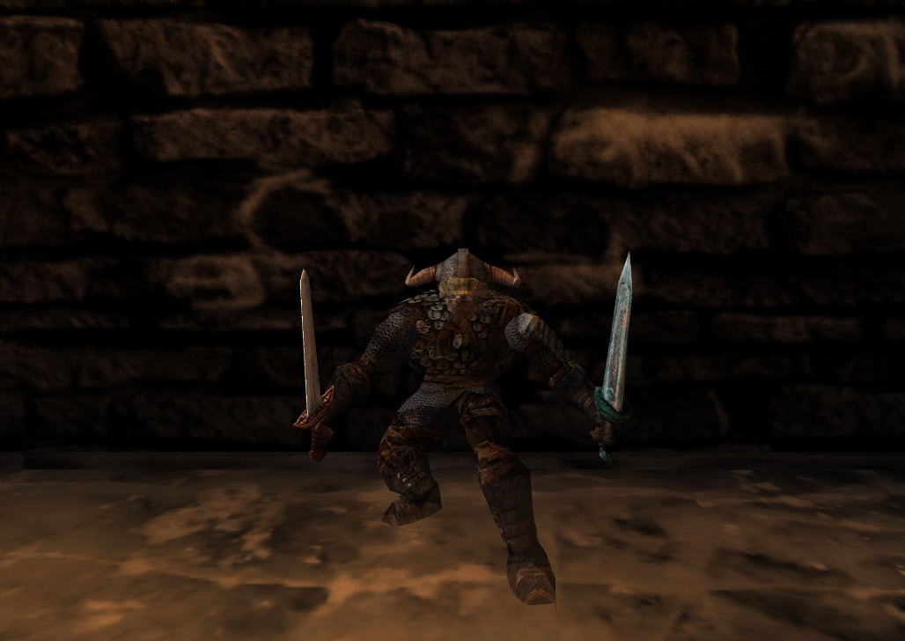
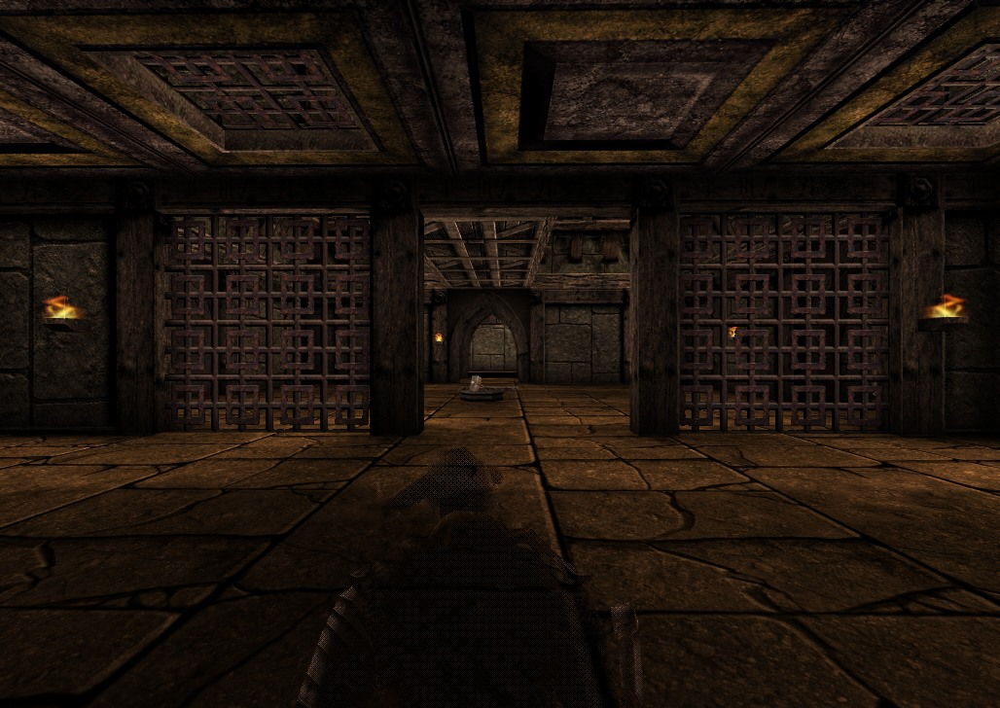
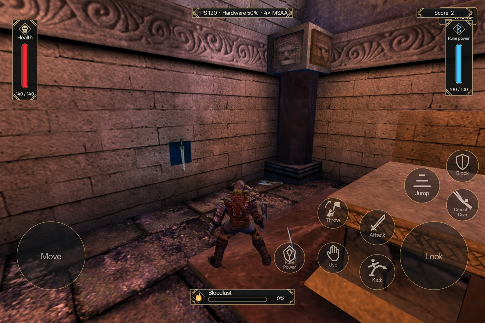
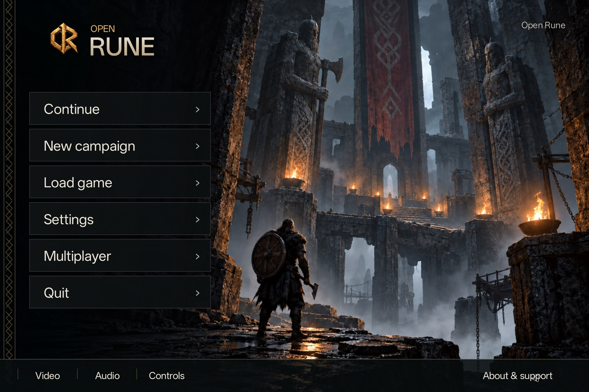

  

<h1 align="center">Open Rune</h1>

  Rune Classic on native Windows and Android, with new combat, physics, multiplayer and graphics options.

  <a href="https://github.com/Mokomis/open-rune/releases/download/v1.0.1/open-rune-1.0.1-windows-x64-client.zip"><strong>Download for Windows</strong></a>
  &nbsp;·&nbsp;
  <a href="https://github.com/Mokomis/open-rune/releases/download/v1.0.1/open-rune-1.0.1-android-arm64.apk"><strong>Download for Android</strong></a>
  &nbsp;·&nbsp;
  <a href="https://github.com/Mokomis/open-rune/releases/tag/v1.0.1">Release notes</a>

*Captured in Open Rune with WIP 4× textures on Ragnar and the surrounding scenery. Dual wielding is an Open Rune addition.*

This started with a simple question. Could I get *Rune Classic* running natively on Android and keep the parts of the game I still love?

Open Rune grew into a native Windows client and dedicated server, an Android port, and a collection of optional changes to combat, movement, physics and presentation. I led the project using ChatGPT and Claude for development, with a local Qwen worker assisting some investigations.

**You need your own copy of Rune Classic.** First-time setup imports its maps, scripts, models, textures and sounds into Open Rune's data folder. [Get Rune Classic on Steam](https://store.steampowered.com/app/210950/Rune_Classic/).

## Start playing

**Current release — Open Rune 1.0.1, build 27**

| Platform | Download | First launch |
| --- | --- | --- |
| Windows x64 | [Client ZIP, about 22 MB](https://github.com/Mokomis/open-rune/releases/download/v1.0.1/open-rune-1.0.1-windows-x64-client.zip) | Extract the ZIP and run **Start Open Rune.cmd**. |
| Android ARM64 | [APK, about 116 MB](https://github.com/Mokomis/open-rune/releases/download/v1.0.1/open-rune-1.0.1-android-arm64.apk) | Install the APK and open **Open Rune**. |
| Windows dedicated server | [Server ZIP](https://github.com/Mokomis/open-rune/releases/download/v1.0.1/open-rune-1.0.1-windows-x64-dedicated-server.zip) | Extract it and follow the included hosting README. |

1. Choose **Use an existing Rune installation** in the setup screen. It also offers a Steam purchase link.
2. Select the complete Rune Classic folder. On Android, copy that folder into accessible device storage first.
3. Let the import finish, then begin a campaign or open **Multiplayer**.

Windows needs a Vulkan-capable graphics driver. If Windows reports a missing Microsoft runtime DLL, install the Microsoft Visual C++ x64 Redistributable. Internet hosting and **Find games** on Windows use a separately installed Node.js x64 runtime. Android bundles its discovery runtime. The Windows dedicated-server launcher also uses Python 3.

Install Android updates over the existing app to retain its data. The in-game update checker links to newer GitHub releases for manual installation.

The published clients are Windows and Android. A macOS development client has been used for testing; macOS distribution and Linux client/server releases are future work.

## Play the campaign or host a match

**The original Rune Classic campaign should be playable from start to finish.** Release testing covered representative levels, transitions and save/load checkpoints. Broader playthrough feedback is welcome.

Choose the original story character or select from **36 original character entries and 37 character/skin combinations**. The browser has animated cards, larger previews and skin selection. Campaign character choice applies when starting a new campaign; existing saves retain their character.

Multiplayer supports **Deathmatch, Team Deathmatch, Arena and HeadBall**, using compatible original maps. Windows and Android players can join the same Open Rune match.

- **Host and play** from the client, or use the Windows dedicated server.
- Set a server name, mode, maps, rotation, limits, starting bots and Laws of Battle before hosting.
- Add or remove bots during a hosted match. Bots use random character appearances and Nordic-flavored names.
- Use **Find games** for public HyperDHT discovery, or join with a shared invitation.
- Keep a player name across matches. Team-colored overhead names identify allies and opponents. Hiding names keeps the team markers; **[BOT]** appears in the scoreboard.
- Connection recovery, movement prediction and adaptive smoothing help with interruptions and irregular updates.

The current participant limit is **16, including bots**. Host and client must have compatible gameplay and network versions. Original Rune servers use a different networking protocol.

## Multiplayer networking

Open Rune's multiplayer uses a new C++ networking layer written for this project. The original Rune gameplay and mode scripts run through an Open Rune host, which decides movement, weapon contacts, damage, blocking, pickups, physics and scoring. This also lets the new combat moves follow the same rules for players and bots.

Clients send their inputs and receive world snapshots and confirmed combat results. Local movement prediction, immediate attack/block presentation and adaptive interpolation keep controls responsive while the host resolves the match. Important events have reliable delivery; current movement and snapshots use update paths that can discard stale information.

Melee keeps its authored attack wind-ups. The host allows up to two simulation ticks, about **33 ms**, for an on-time block that arrives late. Committed damage stays committed.

The networking uses Mbed TLS for authenticated DTLS encryption and HyperDHT for public discovery and peer connections. These libraries provide the security and discovery foundations for Open Rune's own game protocol.

[Networking source](Network) · [Combat timing](Docs/RunePort/NETWORK-RESPONSIVENESS.md) · [Combat animation playback](Docs/RunePort/COMBAT-INTERPOLATION.md)

### How Find games builds the server list

Public hosts advertise their identity through **HyperDHT**, a distributed peer-discovery network. The browser assembles its list by finding those hosts and asking them for their current status. We operate no central Open Rune master directory.

1. Choose **Host game** with public visibility and start the match. Your client or dedicated server announces the host identity to the shared network.
2. Another player opens **Find games**. Open Rune looks for hosts advertising the compatible protocol.
3. Each candidate must answer a fresh, authenticated status request before it appears. The browser shows the match name, mode, current map, player count and capacity.
4. Selecting a host requests a player slot and establishes the encrypted connection. The Open Rune host continues to run the match and decide gameplay.

Refresh checks hosts again, helping filter stale advertisements after a host stops or disconnects. Discovery is best effort; one search may find only some available matches. HyperDHT uses public bootstrap infrastructure to find peers and can attempt NAT traversal. Restricted networks or blocked UDP can still prevent joining.

A hosted match lasts while its host runs. Players can host for a game night or run the Windows dedicated server for longer sessions. Invitation-only matches use shared invitations and stay out of the public list.

[Discovery implementation and hosting details](Tools/RuneDiscovery/README.md)

## Choose your Laws of Battle

Single-player and multiplayer have separate checklists. Choose campaign rules before starting or change them under **Settings → Gameplay → Laws of Battle**. Hosts choose multiplayer rules before starting their match. Eligible enemies and bots obey the enabled rules.

| Law | What it adds |
| --- | --- |
| Kick | A close-range shove. Shields absorb most of its force. A sword strike that catches an exposed kicking leg can sever it, leaving a surviving fighter hopping and bleeding. |
| Shield bash | Double-tap Block with a shield for a swipe, head recoil and a brief stun on a clean hit. |
| Dual wield | Use a second compatible one-handed weapon. Attacks alternate between hands. |
| Crossed-weapon block | Hold Block with two weapons for weaker protection than a shield. |
| Giant leap | Double-tap Jump in a direction during multiplayer. |
| Shield rush | Hold Block and press Attack with a shield to stow the weapon and charge forward. |
| Two-handed aerial slam | Jump, tap Jump again in the air, then Attack with a heavy two-handed weapon. |
| Corpse pickup & throw | Use near an intact, finished corpse to lift it. Attack or Throw launches it; Use drops it. |
| Loose prop interaction | Lift, throw or kick eligible loose stools, kegs and buckets. |
| Physical knockdowns | Strong impacts can send eligible fighters into recoverable ragdolls. |
| Tactical campaign enemies | Give eligible campaign humanoids more deliberate spacing, defense and use of permitted moves. |
| Special moves without rage | Allow the enabled leap and shield rush without bloodlust. Equipment requirements and cooldowns still apply. |
| Spider Monkeys | Jump toward a wall and Use to grab it, then move to climb or traverse. |

**Giant leap is disabled for everyone in the campaign.** Spider Monkeys defaults Off there. Bosses, scripted actors and incompatible creatures retain their movement safeguards.

[Full Laws of Battle controls and rules](Docs/RunePort/LAWS-OF-BATTLE.md) · [Character selection](Docs/RunePort/CHARACTER-SELECTION.md)

## Physics and character movement

**Standard** physics is the default and uses the more exaggerated behavior previously called Chaos. **Cinematic** and **Legacy** are also available.

Supported characters have foot placement on uneven ground, physical hit reactions, recoverable knockdowns and articulated corpses. Hard wall impacts can add damage and stun. Combat-driven bodies and thrown props can break eligible loose objects. Scripted scenery has its own handling.

Animation interpolation and multiplayer combat playback have been improved, including dual-wield poses, attack anticipation and block response. Living characters show breath outdoors. Undead have their breathing idle motion suppressed and use additional idle gestures.

[Physics details](Docs/RunePort/CINEMATIC-PHYSICS.md) · [Character IK and reactions](Docs/RunePort/CHARACTER-IK-ACTIVE-PHYSICS.md) · [Combat interpolation](Docs/RunePort/COMBAT-INTERPOLATION.md)

## Graphics, audio and controls

The themed settings menus group each feature under Video, Audio, Controls, Interface or Gameplay.

| Area | Options and changes |
| --- | --- |
| Lighting | Original, per-pixel and remastered lighting; nearby moving shadows with up to eight shadow-casting lights on Windows and Android; physical material response and local environment lighting. |
| Surfaces | Material maps, surface detail and depth, adaptive sharpening, up to 16× anisotropic filtering, shadow/midtone tuning and optional ambient occlusion. |
| Water | Original and Enhanced water, plus experimental native Crest waves, refraction and underwater distortion. |
| Effects | Fuller fire, embers, combat impacts, gore and persistent blood stains. |
| Weather | Changing Clear, Light and Heavy snowfall in outdoor areas. Each client can follow automatic weather or force Off, Light or Heavy. |
| Display | Widescreen framing, a field-of-view slider, selectable frame-rate targets and Off/2×/4× MSAA. Android also has refresh-rate requests and frame pacing. |
| Android scaling | Native, 75%, 50% or 25% rendering with Hardware Scaling or Snapdragon GSR. The settings show the active resolution and scaling method. |
| Audio | Environmental reverb, sound muffling and optional headphone spatial audio. |
| Input and HUD | Keyboard/mouse navigation, controller support and device-dependent rumble. Android has movable/resizable HUD elements, horizontal or vertical meters, two touch sticks and movable/resizable touch buttons. |

Touch controls hide when a physical controller is connected, while Menu stays available. Double-tapping the center of the right touch stick also jumps.

Crest and ambient occlusion remain experimental and can be expensive on mobile GPUs. Hardware Scaling depends on the device's display path and may use GPU composition. Performance varies with the map, effects, bot count, device and render resolution.

[Native Crest implementation](Docs/RunePort/CREST-NATIVE.md) · [Material lighting](Docs/RunePort/MATERIAL-LIGHTING-PROBES.md) · [Outdoor weather](Docs/RunePort/SNOW.md)

## Optional remastered textures

**Original artwork is the default. Both WIP 2× and WIP 4× are unfinished and incomplete.**

Select either WIP tier under **Video → Textures & surfaces**. Open Rune shows the download size and asks permission. **Cancel** keeps your current artwork. **Download** prepares the pack on an unmetered connection, then applies the selected tier. You can play with Original while it installs.

The shared pack contains **542 approved remasters**, covering **698 in-game texture entries** at both resolutions. Assets without a replacement use their original artwork. The artwork combines local AI upscaling and generative remaster work, with color calibration, mipmaps and material maps.

| Platform | Download | Installed pack |
| --- | --- | --- |
| Windows | About 9.1 GB | About 21.6 GB |
| Android | About 4.25 GB | About 4.25 GB |

Allow additional space for the download and extraction. Downloading either tier makes both tiers available. Switching between installed tiers needs no further download. Texture resolution and the game's rendering-resolution percentage are separate settings.

The older 1.0.0 release stores the texture parts used by the in-app downloader. GitHub labels them **Optional WIP textures · Downloaded by Open Rune**.

| Original artwork | WIP 4× artwork |
| --- | --- |
|  |  |

## Screenshots

These captures show development builds. Select an image to see it at full size.

| Android gameplay and touch controls | Themed title screen |
| --- | --- |
|  |  |

| Multiplayer on Thorstadt | Water on DM-Seaside |
| --- | --- |
|  |  |

## How this was built

Open Rune builds on **SurrealEngine**, an open-source reimplementation of the engine used by games from the Unreal Engine 1 era. Our fork runs Rune Classic's original content and UnrealScript through a native C++ engine, compiled for Windows x64 and Android ARM64, with Vulkan rendering.

The work combines source development with investigation of original-game behavior and binaries to recover missing engine contracts. New native systems handle networking, interface, input, rendering and optional combat. Jolt supplies the rigid-body physics backend. The water implementation adapts the MIT-licensed Crest 4.23.0 spectrum and FFT work to Vulkan.

AI-assisted work was checked through builds, native gameplay tests, repeatable input runs, screenshots and device testing. The original campaign, scripts and licensed game data still supply the worlds and much of Rune's behavior.

## Recent patches

| Release | Included updates |
| --- | --- |
| **1.0.1 · build 27** | Permission before a WIP texture download, a displayed download size, Cancel retaining the current artwork, and automatic application of the selected tier when installation finishes. |
| **1.0.0 · build 26** | Consolidated combat, character, physics, rendering and multiplayer updates; first-run game-file import; all approved 2×/4× remasters; and a host-join fix for intermission and map rotation. |

The Windows and Android release checks exercised game-file import, representative campaign save/load flows, the four multiplayer modes, discovery/joining and connection recovery. Build 27 also passed the OPPO download-prompt test with an empty cache, both Cancel paths, installation, switching tiers and in-game 2×/4× texture loading. Windows passed the consent flow and full installation using cached archives.

## Development and credits

The release includes the matching source archive, checksums, component notices and library sources. The update checker reports new versions and links to GitHub; installation of updates is manual. Multiplayer compatibility checks cover network protocol, gameplay rules and required content.

[Android build instructions](Android/README.md) · [Windows development instructions](Windows/README.txt) · [Networking and discovery](Tools/RuneDiscovery/README.md) · [Release history](https://github.com/Mokomis/open-rune/releases)

Open Rune is an independent fan project. SurrealEngine is by Magnus Norddahl, Lupert Everett and contributors. Rune Classic and its original artwork belong to their respective rights holders.

[SurrealEngine upstream](https://github.com/dpjudas/SurrealEngine) · [Project and dependency licenses](LICENSE.md) · [Component notices](NOTICE.txt)
