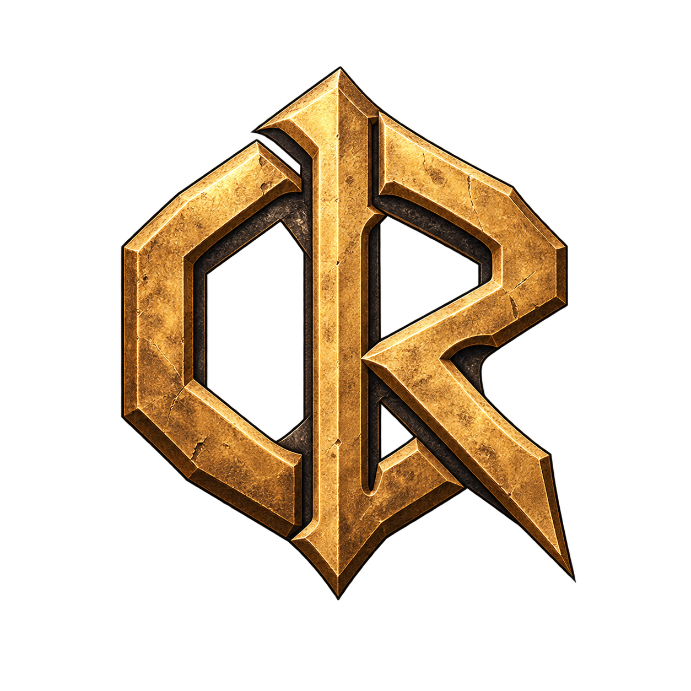
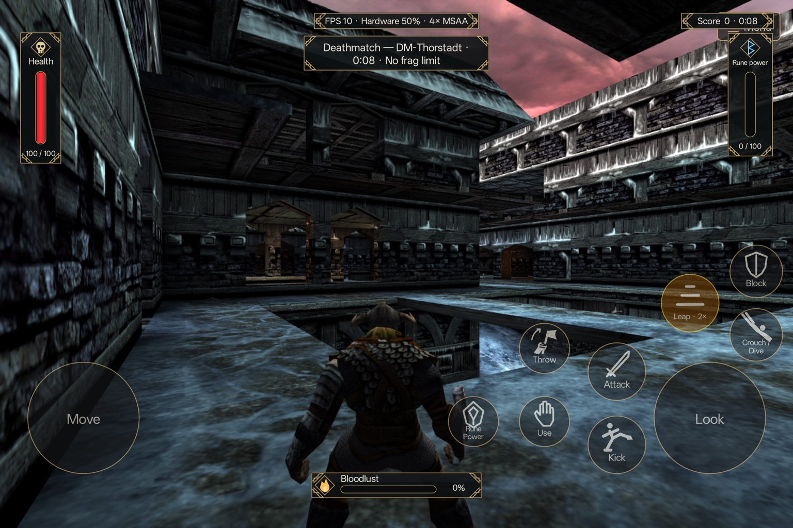
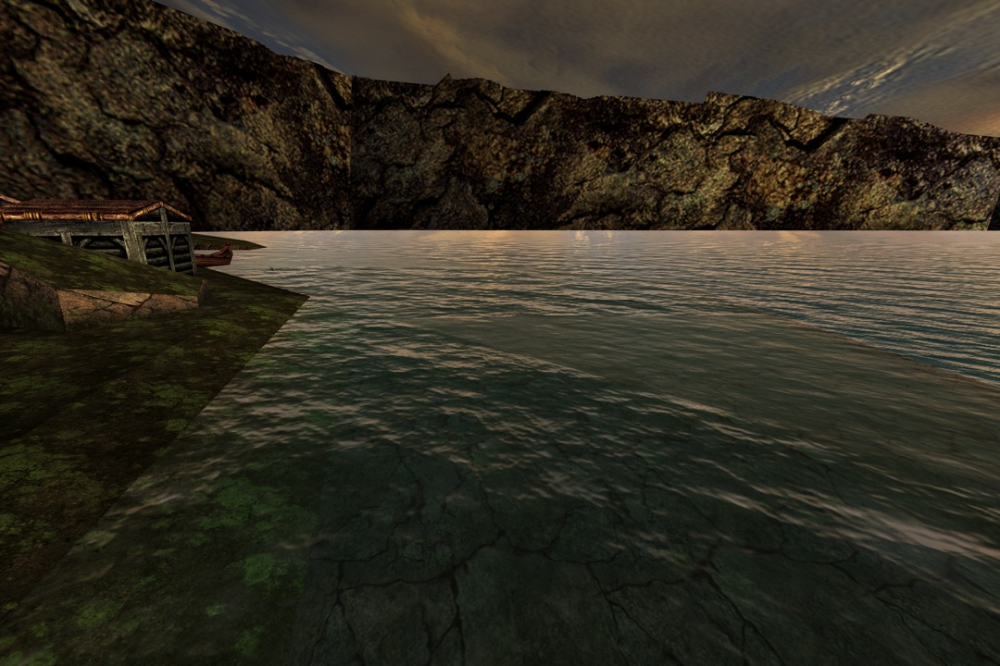
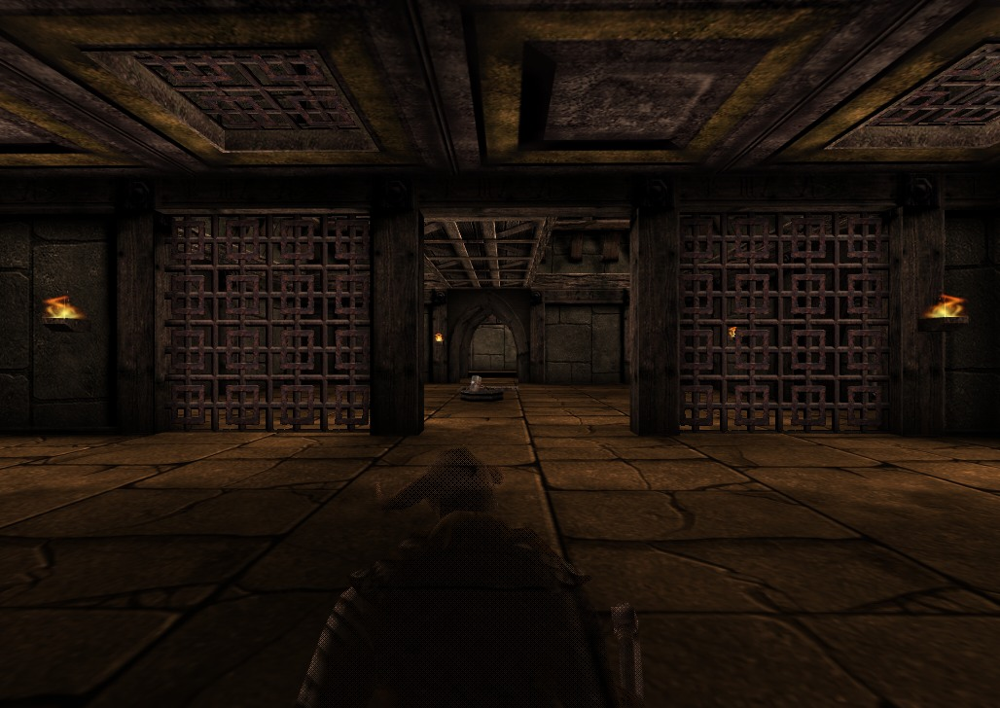

# Open Rune

This started with a simple question. Could I get *Rune Classic* running natively on Android and keep the parts of the game I still love?

Open Rune is an AI-first fan project. I led the work and used ChatGPT and Claude throughout, with a local Qwen worker for some of the investigation. It grew from an Android port into a Windows client and dedicated server, with a new interface, multiplayer, combat options, and a remastered texture pack.

You need your own copy of *Rune Classic*. Open Rune imports the original maps, scripts, models, textures, and sounds from your installation.

## Download and install

1. Get the Windows x64 client or Android ARM64 APK from [GitHub Releases](https://github.com/Mokomis/open-rune/releases). On Windows, extract the client ZIP before launching.
2. On first launch, select the folder containing your *Rune Classic* installation. On Android, copy that folder to shared storage first. Open Rune imports the game files into its own data folder.
3. Start the campaign or open **Multiplayer** to host or join a game. The Windows dedicated server is a separate download with its own hosting instructions.

**Single-player campaign.** The original Rune Classic campaign should be playable from start to finish. Release testing covered representative levels, transitions, and save/load checkpoints.

Windows uses Node.js for internet hosting and discovery. Android includes its discovery runtime. Install APK updates over your existing Open Rune app to keep your saves and settings.

### Remastered textures

Open Rune downloads and installs the texture pack in the background after the original game files are imported. The download waits for an unmetered connection and enough free space. You can play while it runs.

The game starts with **Original** artwork. When the pack is ready, choose **WIP 2×** or **WIP 4×** under **Video → Textures & surfaces**.

**Both the 2× and 4× texture sets are work in progress and incomplete.** The two settings use the same set of remastered assets at different resolutions.

The pack includes **542 approved remasters** covering **698 in-game texture entries** at both sizes. Textures without a matching replacement use the original artwork. Texture detail is independent of render resolution.

## How it works

Open Rune builds on the open-source **SurrealEngine** project. We adapted its C++ engine to run the original *Rune Classic* content and UnrealScript, then compiled it for Windows x64 and Android ARM64. We checked the original game's behavior to recover details such as movement, animation, inventory, and multiplayer rules. Vulkan renders the game on both platforms.

I wanted to keep the original maps and campaign while giving players a choice about the changes. The menus, touch controls, networking, and optional gameplay systems live in Open Rune. The original game files supply the worlds and much of the behavior that makes them feel like *Rune*.

## What's new

- **Interface and controls.** A new title and pause menu, keyboard and mouse navigation on Windows, resizable touch controls and HUD on Android, plus controller support.
- **Combat and physics.** Laws of Battle let you choose additions such as kicks, shield bashes, shield rush, dual wielding and crossed-weapon blocks. Standard physics adds active ragdolls and corpse pickup and throwing. Legacy physics is available. Giant Leap is a multiplayer option.
- **Multiplayer.** Host from the game or run a dedicated Windows server. Find games through internet discovery or join with an invitation. Play Deathmatch, Team Deathmatch, Arena, and HeadBall with character selection, bots, and map rotation.
- **Graphics.** Original and remastered lighting options, moving shadows, ambient occlusion, Crest-derived waves and underwater distortion, outdoor snow, and widescreen field-of-view controls. Android has separate hardware and software render-scaling options.

## Screenshots

Captured in pre-release Open Rune builds. Select an image to open it at full size.

| Android gameplay and touch controls | Redesigned title screen |
| --- | --- |
|  |  |
| **Multiplayer on Thorstadt** | **Water on DM-Seaside** |
|  |  |

| **Windows original artwork** | **Windows WIP 4× textures** |
|  |  |

Open Rune is an independent fan project based on SurrealEngine. The original game and its artwork belong to their respective rights holders.
